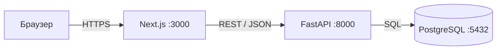

# AI Education Quality — Web Application


Жалпы білім беретін мектептерде білім сапасын басқаруда жасанды интеллект технологияларын қолдануға арналған веб-қосымша.

## Зерттеумен байланысы

**Тақырып:** Жалпы білім беретін мектептерде білім сапасын басқарудағы жасанды интеллект технологиялары

**Мақсаты:** Мектептердегі білім сапасын бағалау және болжау үшін ЖИ технологияларын қолдану.

## Архитектура



| Компонент | Технология | Рөлі |
|-----------|-----------|------|
| Фронтенд | Next.js, TypeScript, Tailwind CSS | Пайдаланушы интерфейсі |
| Бэкенд | Python, FastAPI, Pydantic | REST API, бизнес-логика |
| Дерекқор | PostgreSQL | Деректерді сақтау |
| Миграциялар | SQLAlchemy 2, Alembic | Кестелерді басқару |
| Инфрақұрылым | Docker, Docker Compose | Бір командамен іске қосу |
| CI | GitHub Actions | Автоматты тесттер |

## Негізгі сущность

**Assessment (Бағалау нәтижесі)** — оқушының белгілі бір пән бойынша алған бағасы.

| Өріс | Тип | Сипаттама |
|------|-----|-----------|
| id | int | Бірегей идентификатор |
| student_name | str | Оқушының аты-жөні |
| subject | str | Пән атауы |
| grade | int | Баға (2–5) |
| assessment_type | str | ТЖБ, БЖБ, тоқсандық |
| date | date | Бағалау күні |
| class_name | str | Сынып |
| teacher | str | Мұғалім |
| comment | text | Ескертпе |

## Быстрый старт

```bash
cp .env.example .env
docker compose up --build
```

- Фронтенд: http://localhost:3000
- API документациясы: http://localhost:8000/docs

### Seed-деректерді қосу (міндетті емес)

```bash
docker compose exec backend python -m scripts.seed
```

Дерекқорға 40 синтетикалық жазба қосылады.

## Локальная разработка (Docker-сіз)

### Backend

```bash
cd backend
uv sync
uv run uvicorn app.main:app --reload
```

### Frontend

```bash
cd frontend
npm install
npm run dev
```

## Тесттерді іске қосу

### Backend тесттері

```bash
cd backend
uv run pytest -q
```

### Backend линтері

```bash
cd backend
uv run ruff check .
```

### Frontend линтері

```bash
cd frontend
npm run lint
```

## Құрылымы

```
webpr/
├── backend/              # FastAPI бэкенд
│   ├── app/
│   │   ├── core/         # Баптаулар
│   │   ├── modules/      # Модульдер (assessments)
│   │   └── main.py       # FastAPI қосымшасы
│   ├── alembic/          # Миграциялар
│   ├── scripts/          # Seed скрипттер
│   ├── tests/            # Тесттер
│   └── Dockerfile
├── frontend/             # Next.js фронтенд
│   ├── src/
│   │   ├── app/          # Беттер (App Router)
│   │   ├── components/   # Компоненттер
│   │   └── lib/          # API клиент, типтер
│   └── Dockerfile
├── docs/                 # Құжаттама
├── .github/workflows/    # CI
└── docker-compose.yml
```

## Деректер туралы

Барлық деректер — **синтетикалық** (seed скрипті арқылы жасалған). Нақты оқушылар туралы ақпарат жоқ. Seed скрипті `backend/scripts/seed.py` файлында.

## API эндпоинттер

| Метод | Жол | Сипаттама |
|-------|-----|-----------|
| GET | `/health` | Жүйе тексеру |
| GET | `/assessments` | Тізімді алу (іздеу + пагинация) |
| GET | `/assessments/{id}` | Бір жазбаны алу |
| POST | `/assessments` | Жаңа жазба жасау |
| PATCH | `/assessments/{id}` | Жазбаны өзгерту |
| DELETE | `/assessments/{id}` | Жазбаны өшіру |

Толық құжаттама: http://localhost:8000/docs

## AI assistance

Бұл жобаны жасау барысында **AI-ассистенттер** (ChatGPT, Claude) келесі жерлерде қолданылды:
- Кодтың жалпы құрылымын жоспарлау
- Қателерді түзету
- Құжаттама жазу

Барлық код **түсініліп, тексеріліп** жазылды.

## Лицензия

MIT License — [LICENSE](LICENSE) файлын қараңыз.

## Автор

**Kanat M.**
Магистрант, Информатика бағыты
2026

- GitHub: [@kanat-m](https://github.com/kanat-m)
- Email: ma09kzz@gmail.com