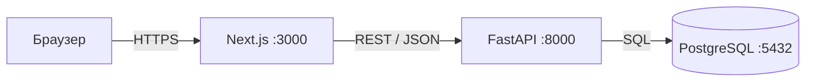

# AI Education Quality — Web Application

Жалпы білім беретін мектептерде білім сапасын басқаруда жасанды интеллект технологияларын қолдануға арналған веб-қосымша.

## Зерттеумен байланысы

**Тақырып:** Жалпы білім беретін мектептерде білім сапасын басқарудағы жасанды интеллект технологиялары

**Мақсаты:** Мектептердегі білім сапасын бағалау және болжау үшін ЖИ технологияларын қолдану.

## Архитектура



| Компонент | Технология | Рөлі |
|-----------|-----------|------|
| Фронтенд | Next.js, TypeScript, Tailwind CSS | Пайдаланушы интерфейсі |
| Бэкенд | Python, FastAPI, Pydantic | REST API, бизнес-логика |
| Дерекқор | PostgreSQL | Деректерді сақтау |
| Миграциялар | SQLAlchemy 2, Alembic | Кестелерді басқару |
| Инфрақұрылым | Docker, Docker Compose | Бір командамен іске қосу |
| CI | GitHub Actions | Автоматты тесттер |

## Негізгі сущность

**Assessment (Бағалау нәтижесі)** — оқушының белгілі бір пән бойынша алған бағасы.

| Өріс | Тип | Сипаттама |
|------|-----|-----------|
| id | int | Бірегей идентификатор |
| student_name | str | Оқушының аты-жөні |
| subject | str | Пән атауы |
| grade | int | Баға (2–5) |
| assessment_type | str | ТЖБ, БЖБ, тоқсандық |
| date | date | Бағалау күні |
| class_name | str | Сынып |
| teacher | str | Мұғалім |
| comment | text | Ескертпе |

## Быстрый старт

```bash
cp .env.example .env
docker compose up --build
```

- Фронтенд: http://localhost:3000
- API документациясы: http://localhost:8000/docs

## Құрылымы

```
webpr/
├── backend/       # FastAPI бэкенд
├── frontend/      # Next.js фронтенд
├── docs/          # Құжаттама
└── docker-compose.yml
```

## Лицензия

MIT License — LICENSE файлын қараңыз.

## Автор

**Kanat M.**
Магистрант, Информатика бағыты
2026